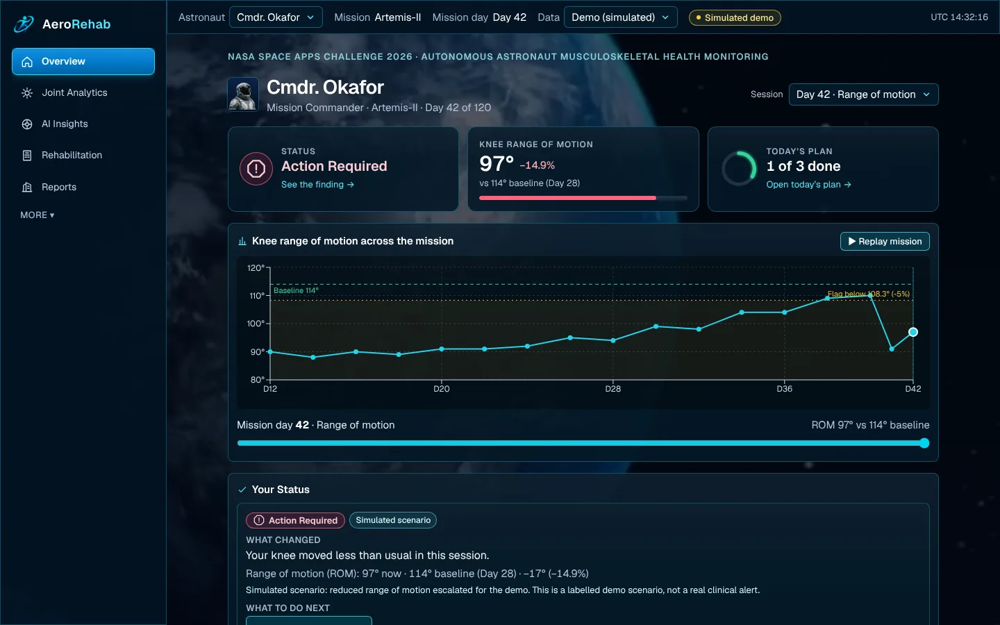
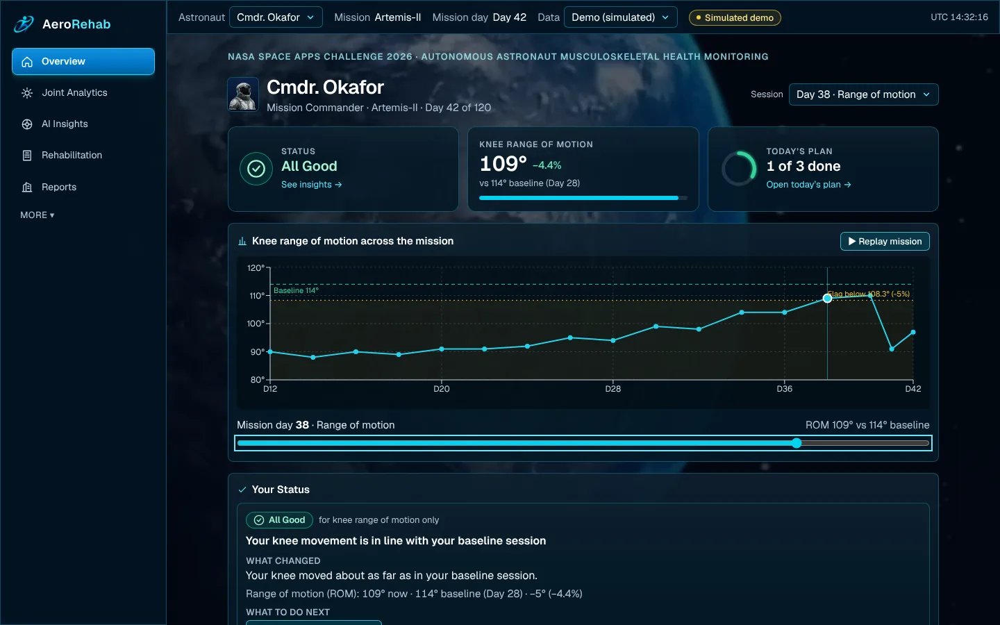
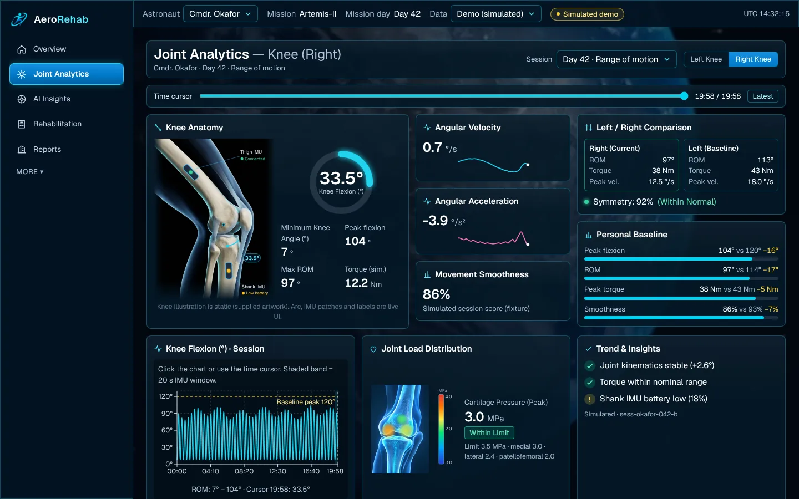
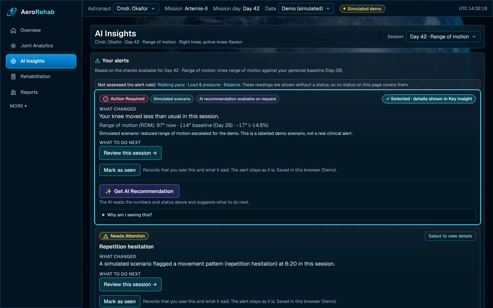
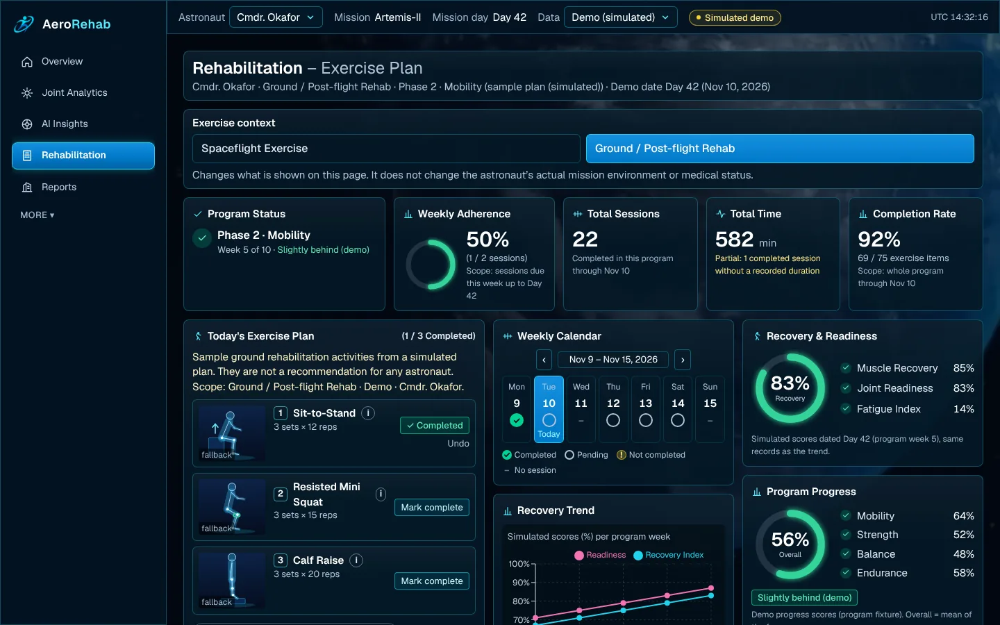
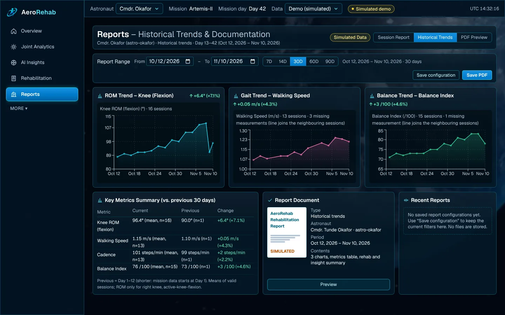
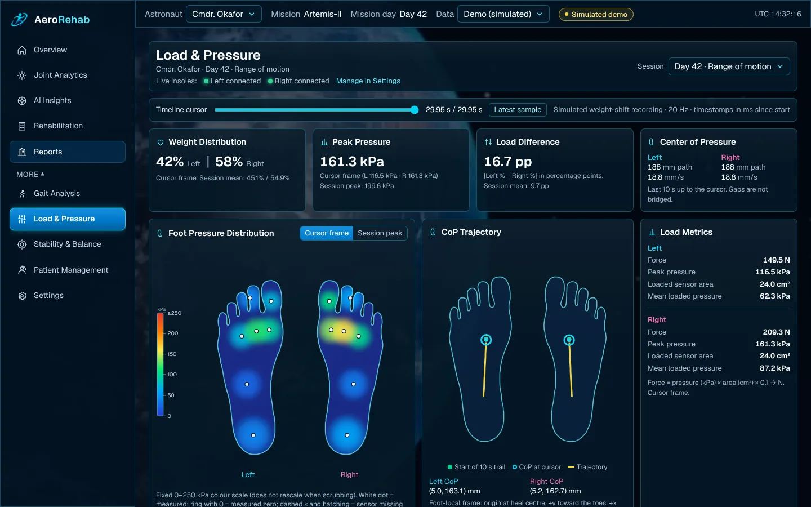
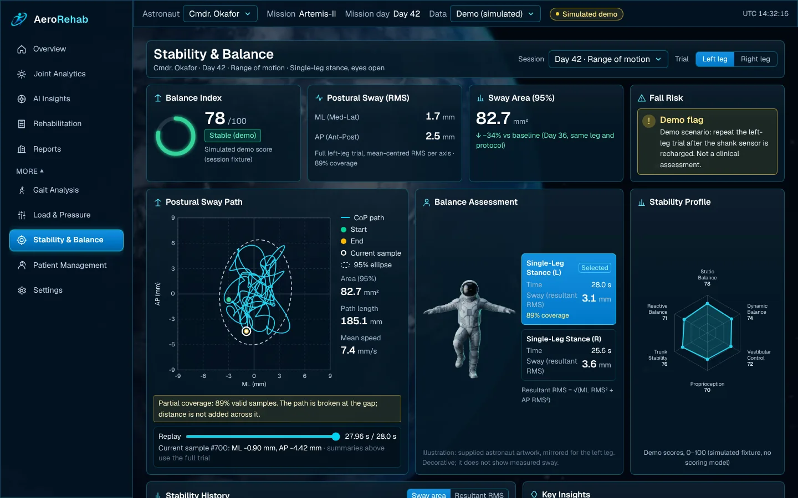
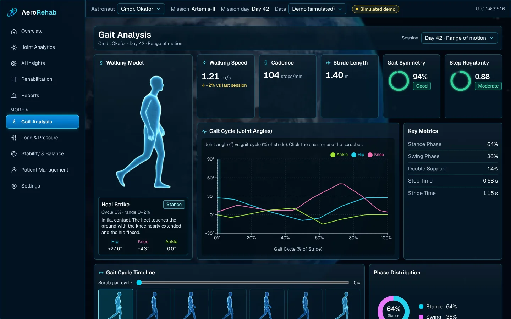
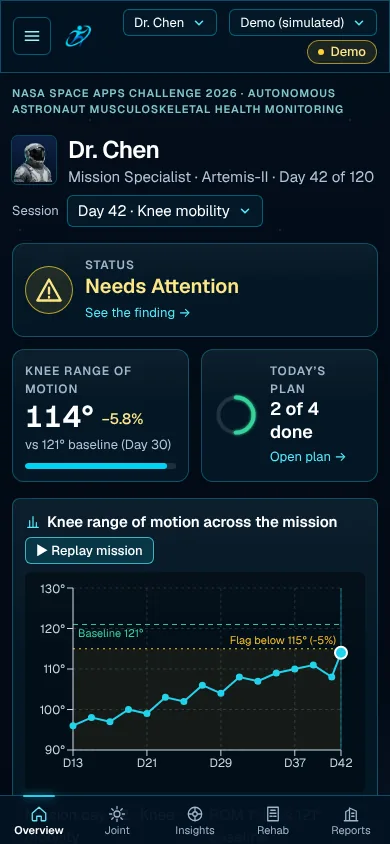

# AeroRehab: Astronaut Knee Health Monitoring for Long-Duration Spaceflight

**Early warning for musculoskeletal deconditioning in space, one knee at a time.**

AeroRehab is our team's project for the **NASA Space Apps Challenge 2026**. It is an astronaut health monitoring dashboard and decision support prototype that tracks **knee range of motion (ROM)** against each astronaut's own baseline, flags meaningful declines during **long-duration spaceflight**, explains every alert in plain language, and points the crew to evidence-informed countermeasures and rehabilitation exercises.

[**Live demo**](https://nasa-aero-rehab.vercel.app/) · [Demo video (30 s)](docs/demo/aerorehab-demo-30s.mp4) · [Run it locally](#run-it-locally) · [Team](#team-aero-rehab)



> **Prototype notice.** All astronaut data in the demo is simulated. AeroRehab is a hackathon prototype, not a medical device, and must not be used for clinical decisions.

---

## Contents
- [The problem](#the-problem)
- [Why we focused on joint movement](#why-we-focused-on-joint-movement)
- [The demo story: Cmdr. Okafor, Day 38 to Day 42](#the-demo-story-cmdr-okafor-day-38-to-day-42)
- [Features](#features)
- [Screenshots](#screenshots)
- [Demo video and slides](#demo-video-and-slides)
- [Run it locally](#run-it-locally)
- [Tech stack](#tech-stack)
- [Limitations](#limitations)
- [Future work](#future-work)
- [Team Aero Rehab](#team-aero-rehab)

## The problem

In microgravity the legs no longer carry body weight, and astronauts lose muscle strength, bone density and joint mobility over weeks and months in orbit. This **musculoskeletal deconditioning** is one of the main health risks of long-duration missions, especially on future flights to the Moon and Mars where crews will be far from ground medical support and communication delays make real-time advice hard.

Crews already exercise every day, but small, gradual losses are easy to miss in raw sensor numbers. What is missing is a simple, autonomous way to answer three questions for each astronaut:

1. Is this person moving the way they normally do?
2. If not, how big is the change, and is it worth acting on?
3. What should they do next?

## Why we focused on joint movement

Our first plan covered a broad set of signals: knee range of motion, physical activity, resting heart rate and sleep. With one hackathon weekend, we chose to go deep on one signal and do it properly instead of showing many shallow charts.

We picked **knee range of motion** because:
- The knee is a load-bearing joint that is directly affected when the legs stop carrying weight, so it is a clear marker of lower-limb deconditioning.
- ROM is easy to explain (degrees of bend) and easy to compare with the astronaut's own earlier sessions.
- It can be measured with small wearable sensors (for example thigh and shank IMUs), so the idea maps to realistic future hardware.
- A single well-explained signal makes the alert logic transparent, which matters for trust in an autonomous system.

Heart rate, sleep and activity are kept as [future work](#future-work).

## The demo story: Cmdr. Okafor, Day 38 to Day 42

The demo follows a simulated crew on a 120-day mission. Cmdr. Okafor is recovering from a right knee meniscus repair, and his personal baseline, recorded on mission Day 28, is a knee range of motion of **114°**.

| Mission day | Knee ROM | Change vs baseline | Status |
|---|---|---|---|
| Day 38 | 109° | -4.4% | **All Good** |
| Day 42 | 97° | -14.9% (about 15% below) | **Action Required** |

On the Overview page, the **mission-day slider** (or **Replay mission**) walks through every session. On Day 38 his ROM is within 5% of baseline, so the status is All Good. On Day 42 it falls to 97°, about 15% below his 114° baseline, so the app raises **Action Required**, explains why in plain language ("Your knee moved less than usual in this session"), and links to the session review and his rehabilitation plan.

| Day 38: All Good | Day 42: Action Required |
|---|---|
|  |  |

The alert threshold (a drop of 5% or more against the personal baseline) is a demo setting, not a clinically validated limit.

## Features

- **Personal baselines.** Each session is compared with the astronaut's own baseline session for the same knee, movement and protocol, not with a population average.
- **Explainable alerts.** Every status (All Good, Needs Attention, Action Required) shows what changed, the numbers behind it, a "Why am I seeing this?" explanation and a suggested next step. Readings without an alert rule are clearly marked "Not assessed".
- **Mission replay.** A mission-day slider and replay button show how knee ROM changes across the mission.
- **Joint Analytics.** Knee flexion over the session, angular velocity and acceleration, left/right comparison, movement smoothness and simulated cartilage load.
- **AI Insights.** A list of findings with **Mark as seen** and an alert history, plus an optional **AI recommendation** (Google Gemini, server-side) with built-in guidance as the fallback. Only numbers and status are sent, never names.
- **Rehabilitation.** A sample exercise plan with progress tracking, and a **NASA Countermeasure Guide** that explains the ISS exercise devices (ARED, T2/COLBERT, CEVIS) with links to the NASA pages behind each statement.
- **More analysis pages.** Gait Analysis, Load & Pressure (foot pressure heatmap and centre of pressure), and Stability & Balance (sway path and 95% ellipse). These show simulated readings without an alert rule.
- **Reports.** Pick a date range, preview the report and save it as a PDF.
- **Two data modes.** **Demo** uses simulated data for three astronauts (Dr. Chen, Cmdr. Okafor, Maj. Alvarez). **Recorded** stores manual entries and imported sensor CSV files in a local SQLite database. The two are always labelled and never mixed.
- **Works on phones.** A responsive layout with a bottom tab bar on small screens.

## Screenshots

| Joint Analytics | AI Insights |
|---|---|
|  |  |

| Rehabilitation | Reports |
|---|---|
|  |  |

| Load & Pressure | Stability & Balance |
|---|---|
|  |  |

<details>
<summary>Gait Analysis and phone layout</summary>





</details>

## Demo video and slides

- **Demo video (30 seconds, English captions):** [docs/demo/aerorehab-demo-30s.mp4](docs/demo/aerorehab-demo-30s.mp4), subtitles in [aerorehab-demo-30s.srt](docs/demo/aerorehab-demo-30s.srt).
- **Slides:** our presentation is part of the Space Apps project submission. _Public link to be added._
- **Live demo:** [nasa-aero-rehab.vercel.app](https://nasa-aero-rehab.vercel.app/). Pick **Cmdr. Okafor** in the top bar and drag the mission-day slider from Day 38 to Day 42.

## Run it locally

Requirements: **Node.js 20 or newer** and npm.

```bash
git clone https://github.com/abdullahjave/Nasa_AeroRehab.git
cd Nasa_AeroRehab
npm install
npm run dev
```

Then open [http://localhost:3000](http://localhost:3000).

Optional:
- **AI recommendations:** copy `.env.example` to `.env.local` and set `GEMINI_API_KEY`. Without a key the app shows its built-in guidance.
- **Recorded mode:** works locally out of the box. The SQLite database is created at `data/aerorehab.sqlite` on first use, or run `npm run db:migrate`.
- **Production build:** `npm run build && npm start`. **Tests:** `npm test`.

More detail (database commands, sensor CSV format, alert history, migrations) is in [docs/DEVELOPMENT.md](docs/DEVELOPMENT.md).

## Tech stack

| Area | Tools |
|---|---|
| Framework | Next.js 16 (App Router), React 19, TypeScript |
| Styling | Tailwind CSS v4 |
| Charts | Recharts |
| Local database | SQLite via sql.js (WebAssembly, no native build step) |
| AI recommendations | Google Gemini (`@google/genai`), server-side only |
| Hosting | Vercel |
| Testing | Node.js test runner |

## Limitations

We want to be clear about what this prototype is and is not.

- **Simulated data.** The astronauts, sessions and sensor readings in Demo mode are simulated. No NASA or third-party dataset is loaded or analysed. See [docs/PROVENANCE.md](docs/PROVENANCE.md).
- **Not a medical device.** The alert threshold is a demo rule, not a clinically validated limit, and the guidance has not been reviewed by clinicians. Do not use it for medical decisions or enter real patient data.
- **Knee movement only.** Alerts cover knee range of motion. Walking pace, load and pressure, and balance are shown without a status.
- **Recorded mode is off on the live demo.** It needs a writable database file, which Vercel does not provide, so the hosted site always shows Demo data. Run the app locally to use Recorded mode.
- **AI recommendations need a Gemini API key.** Without one, or if the service is slow, the app shows built-in guidance.
- **No live sensors and no sign-in.** Recorded data is typed in or imported from CSV files, and there is no access control.
- **Asset licences.** Some images and 3D models still need licence confirmation; see [assets/ATTRIBUTIONS.md](assets/ATTRIBUTIONS.md).

## Future work

- Add the other signals from our original plan: physical activity, resting heart rate and sleep, each against a personal baseline.
- Connect real wearable sensors (thigh and shank IMUs, pressure insoles) instead of simulated or imported data.
- Use alert rules that look at trends over several sessions, with thresholds reviewed by clinicians.
- Validate the approach with published spaceflight and bed-rest research data.
- Add sign-in, access control and secure storage so real data could be handled safely.
- Support offline use on board, where ground contact is delayed or unavailable.

## Team Aero Rehab

AeroRehab was built by a team of six for NASA Space Apps Challenge 2026:

| Name | Role |
|---|---|
| **Bisma Zafar** | Concept and clinical direction (physiotherapy), slides and demo video |
| **Abdullah Javed** | Built the app |
| **Muhammad Talal Jamil** | Software engineer, technical lead on the final polish |
| **Fatima Arif** | Slides and voiceover |
| **Lajpat Rai** | Research and ideas |
| **Kashaf Noor Babar** | Review and demo testing |

Thanks to the NASA Space Apps Challenge organisers and to NASA for the public information on astronaut exercise and countermeasures that the Rehabilitation guide links to.

---

<sub>Keywords: NASA Space Apps Challenge 2026, astronaut health monitoring, musculoskeletal deconditioning, knee range of motion, long-duration spaceflight, microgravity, decision support, space medicine, rehabilitation dashboard, wearable sensors.</sub>
